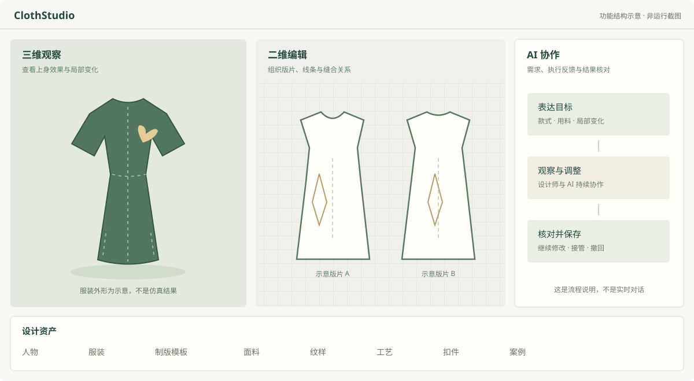

# ClothStudio

### 人与 AI 共同完成服装设计

ClothStudio 探索把二维版片编辑、三维试衣、服装资产与对话式设计助手放在同一工作环境中。设计师可以直接调整服装，也可以向 AI 描述目标，在观察结果后继续修改、保存或撤回。

**这是项目的公开展示仓库，不是完整产品源码，也不是在线服装设计器。** 核心实现、私有素材和内部开发历史不在本仓库中。



*上图是为公开介绍单独绘制的功能结构示意，不包含真实服装版片、人物模型或产品运行数据。*

## 项目关注什么

| 设计需求 | 产品中的工作方式 |
| --- | --- |
| 能继续修改的服装 | 通过版片与缝合关系组织设计，保留后续改款的空间。 |
| 平面与上身效果一起看 | 二维编辑与三维试衣辅助设计师判断尺寸、结构和外观。 |
| AI 能实际参与操作 | 对话提出任务，在授权范围内编辑，再根据结果核对。 |
| 素材能用于设计 | 人物、服装、面料、纹样等资产支持设计过程，而非只有展示图片。 |
| 设计过程可管理 | 正式结果与修改过程有区分，支持保存、继续和撤回。 |

## 已完成的本地演示

2026 年 11 月 9 日的实际桌面操作记录覆盖：

1. 新建项目并选择人物。
2. 通过右侧 AI 对话制作可编辑旗袍。
3. 应用已有墨绿色面料。
4. 将两侧开衩提高 30 mm。
5. 添加宽约 120 mm 的局部花卉贴花。
6. 保存，并关闭、重新打开项目检查设计是否保留。

这是经过分段续做的本地演示。它验证了上述编辑与保存路径，**不代表全部衣服、人物和仿真场景均已通过**。局部碰撞、领口合体、停稳质量和长任务效率仍在完善。详见 [演示与验证范围](docs/DEMO.md)。

## 浏览公开展示页

直接打开本仓库的 [`index.html`](index.html)，或在克隆后的目录运行：

```sh
python -m http.server 8080 --bind 127.0.0.1
```

然后访问 `http://127.0.0.1:8080`。页面只使用本地 HTML、CSS、JavaScript 和原创 SVG 示意图，不需要安装依赖、登录或 API Key。流程按钮仅用于浏览说明，不执行设计或调用模型。

## 阅读导航

- [功能与操作逻辑](docs/FEATURES.md)
- [演示与验证范围](docs/DEMO.md)
- [公开范围与私有边界](docs/PUBLICATION-SCOPE.md)
- [权利说明](RIGHTS.md)
- [素材与第三方说明](THIRD_PARTY_NOTICES.md)

## 仓库用途

本仓库用于项目介绍、交流及比赛展示材料准备。比赛若要求完整源码或可复现程序，需要另行按其规则安排提交；本仓库不冒充完整源码交付。

公开内容未采用开源许可证。公开可见与开源授权不同，相关说明见 [RIGHTS.md](RIGHTS.md)。不在这里上传真实客户项目、账号信息或内部资料。

---

**English:** ClothStudio is a human–AI collaborative garment-design project. This repository contains only a standalone presentation page, original explanatory diagrams, and a description of a locally demonstrated workflow. It excludes the production editor, simulation engine, agent implementation, private datasets, and proprietary assets. It is neither a runnable garment-design application nor a full-source release.
